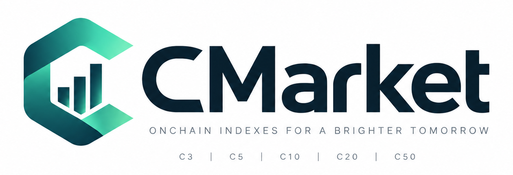

# C Market

<p align="center">
  
</p>

> A mobile-first, on-chain basket experience for the Solana Mobile ecosystem.

## Guía operativa vigente — 17 de octubre de 2026

C Market ofrece una evaluación Android/Seeker de C3: depósito de USDC de prueba,
asignación BTC/ETH/SOL objetivo 40/30/30 con router de prueba, participaciones
on-chain, venta, quema y reclamo. Mainnet permanece deshabilitado. Los precios
reales de mercado son informativos; no convierten los activos simulados en activos reales.

**Punto de entrada documental:** [estado y pendientes](docs/STATUS.md),
[transferencia de contexto](docs/HANDOFF.md), [producto](docs/PRODUCT.md),
[arquitectura vigente](docs/ARCHITECTURE.md), [decisiones](docs/DECISIONS.md)
y [reglas de trabajo](AGENTS.md). La aplicación vigente de esta rama está en
apps/c3-pilot, variante evaluation; apps/mobile conserva el prototipo anterior.
No hay package.json en la raíz: ejecutar comandos en el paquete correspondiente.

Versión declarada: **0.1.38, Android code 39**; paquete
com.dominaweb3.cmarket.c3evaluation. Fuente de versión: apps/c3-pilot/variants/evaluation/app.json.
El nombre npm 0.1.0/0.1.1 de los paquetes no es la versión del APK.
Código: [rama de entrega](https://github.com/dominaweb3-art/cmarket-clock-in/tree/delivery/c3-devnet-evaluation).
Web configurada: https://cmarket-nine.vercel.app/.
APK: https://cmarket-nine.vercel.app/downloads/c-market-c3-devnet-evaluation-0.1.38.apk.
La disponibilidad de la web no se volvió a comprobar el 17 de octubre.

### Tecnologías y preparación del entorno

Declaradas en los manifiestos: TypeScript 6.0.3; Expo 57.0.26; React 19.2.3;
React Native 0.86.3; MWA protocol 2.3.0; AsyncStorage 2.2.0; servicios con
web3.js 1.99.0 y pg 8.23.0; Anchor/Rust 0.31.1, Rust edition 2021;
web Vercel Node 24 y esbuild 0.28.2. No se reinstalaron ni validaron herramientas hoy.

Requisitos: Node/npm compatibles con los paquetes, Android SDK/Java para APK,
Seeker con depuración para QA física y wallet compatible con MWA. Expo Go no
sustituye el build Android nativo. Para el programa se necesitan Rust, Anchor y
herramientas Solana compatibles; confirmar las versiones instaladas antes de usarlas.
El builder actual usa ANDROID_HOME o ANDROID_SDK_ROOT y el material Android de
evaluación ya existente, ignorado por Git. No generar otra identidad para resolver
un error de configuración ni borrar datos al instalar.

Preparación futura, solo bajo encargo de ejecución; estos comandos no se ejecutaron hoy:

    cd services/c3-mainnet
    npm ci
    cd ../../apps/c3-pilot
    npm ci
    cd ../c3-evaluation-web
    npm ci

### Ejecución y comprobaciones por paquete

Desde apps/c3-pilot:

    npm run typecheck
    npm run lint:check
    npm run format:check
    npm test
    npm run doctor
    npm run android:export

El script específico de evaluación es scripts/build-evaluation-apk.mjs dentro
de ese paquete. Ejecutarlo con node solo al preparar un APK autorizado: realiza
prebuild/Gradle, usa el certificado existente y rechaza sobrescribir un APK previo.
No usar por accidente el builder QA/Mainnet ni un comando con --clean.
Para desarrollo nativo, el paquete contiene android:prebuild; Metro de la variante
se inicia desde apps/c3-pilot/variants/evaluation con el CLI Expo instalado, no
desde c10-pocket. La entrega al jurado debe funcionar sin Metro ni Mac.

Desde services/c3-mainnet: npm run typecheck, npm test, npm run lint:check y
npm run format:check. Las suites test:postgres crean procesos/archivos y una base
temporal; no son una comprobación documental de solo lectura.
Desde apps/c3-evaluation-web: npm run build:evaluation genera bundle/recursos;
node --test scripts/prices.test.mjs comprueba el colector de precios con fixtures.
Los scripts de provisión, faucet, ciclo alojado y despliegue pueden enviar
transacciones: leerlos y confirmar alcance antes de ejecutarlos.

### Configuración, infraestructura y publicación

La variante de evaluación fija red, programa y origen HTTPS en código; no usa
los EXPO_PUBLIC_* del prototipo apps/mobile. El servidor requiere POSTGRES_URL,
C3_EVAL_GOVERNANCE_KEY, C3_EVAL_KEEPER_KEY, C3_EVAL_MINT_KEY y C3_EVAL_QUOTES_KEY.
Son configuración secreta de servidor: nunca documentación, chat, Git ni APK.
Los adaptadores rechazan identidades que no coincidan con las públicas previstas.
No se leyeron sus valores ni se confirmó su presencia hoy.

Vercel sirve presentación/descargas y API; PostgreSQL alojado en Supabase mantiene
el esquema c3_eval; Solana Devnet mantiene custodia y participaciones. Los precios
proceden de Coinbase Exchange. Véase [arquitectura](docs/ARCHITECTURE.md).
El proyecto Vercel configurado es cmarket. Antes de publicar, comprobar equipo,
proyecto, commit, aislamiento, ausencia de secretos, APK/certificado/hash y salud.
Una publicación autorizada utiliza el bundle de evaluación y promoción comprobada;
no publicar simplemente por abrir este README. No enviar formularios automáticamente.

### Solución de problemas y límites

- Sesión vencida: volver a verificar propiedad mediante mensaje MWA; conservar
  firma e intent originales. Conectar no equivale a autenticar ni comprar.
- Solicitud/plan vencidos: consultar y conciliar el original; la renovación es
  explícita. Nunca reenviar una firma incierta ni bajar mínimos automáticamente.
- Compra pendiente: un depósito confirmado no implica participaciones emitidas.
  El último registro de 100 USDC seguía pendiente; ver STATUS antes de repetirlo.
- Valor de mercado: spot/24 h reales y referencia orientativa de cesta; no son
  USDC rescatables. Si falta precio, mostrar indisponibilidad, no inventar datos.
- Posición cerrada: cero participaciones; depósito previo en Actividad, no saldo activo.
- Expo Doctor: último aviso documentado 18/19 por 57.0.26 frente a ~57.0.27;
  no actualizar dependencias solo para silenciarlo.
- Instalación: conservar certificado y datos; detenerse ante firma incompatible.

## Registro histórico conservado

Las secciones siguientes se mantienen como procedencia. Sus referencias a
0.1.14, apps/mobile, iconos pendientes, candidato Mainnet o pago a tesorería
no sustituyen la guía vigente ni acreditan funcionamiento actual. El alcance
físico de 0.1.14 está documentado y no se extiende automáticamente a 0.1.38.

C Market is an experimental Android application designed for Seeker users who want a simple, transparent way to explore predefined crypto-asset baskets such as C3, C10, and future basket sizes.

The project is being prepared for **CLOCK IN — A Solana Mobile Hackathon**.

## Active delivery: Devnet evaluation — 10 October 2026

The delivery branch is `delivery/c3-devnet-evaluation`. It uses separate,
worthless test assets and a test router, not real BTC/ETH exposure or Jupiter
Devnet liquidity. Mainnet remains disabled; the historical candidates below
are preserved and do not describe the current evaluation artifact.

Both evaluation programs have been deployed and finalized on Solana Devnet.
Their deployed bytes match the prepared binaries. The hosted backend and
PostgreSQL journal run at <https://cmarket-nine.vercel.app>.
The signed **0.1.14 / Android code 15** APK is installed on Seeker with the
existing evaluation certificate, preserving prior artifacts and stable apps.
The physical Phantom/MWA cycle passed on 10 October: ownership-message proof,
1 test USDC deposited, three test buys, 1 on-chain evaluation share, restart
and position recovery, three test sales, share burn and **0.99 test USDC** returned.
All ten economic signatures are finalized without errors on official Devnet RPC;
the hosted semantic verifier checked effects before durable advancement.
Activity displays verified receipts with Devnet Explorer links. Repeat claim is
disabled after redemption, with the backend's duplicate-claim guard retained.
This is a functional test-token evaluation, **not a Mainnet investment product**.
Download the exact signed APK and SHA-256 at <https://cmarket-nine.vercel.app/>.
See [current evidence and limitations](docs/C3_DEVNET_EVALUATION_QA.md).
See [judge instructions and recording script](submission/c3-devnet-delivery.md).

## Active restricted C3 candidate — 5 October 2026

The current open-vault work is in `apps/c3-pilot`, `services/c3-mainnet` and
`programs/c3-pilot-vault`; the earlier `apps/mobile` CLOCK IN/Devnet application
is preserved separately. The candidate permits exactly one authorized wallet,
one lifetime deposit of 1 USDC and one full redemption per vault. Its target is
40% cbBTC, 30% Portal ETH and 30% WSOL held by the vault PDA, with on-chain shares.
Other baskets remain upcoming. Prices are informational; payout is actual
finalized USDC proceeds, not a promised return of 1 USDC.

The updated six-leg local validator/PostgreSQL cycle passed, including explicit
owner-approved minimum recovery after a partial buy, share issuance, all three
sales, burn and claim. This uses cloned Jupiter programs/pools, synthetic funding
and test keys: **it is not a Mainnet purchase or physical MWA acceptance**.
Mainnet execution and mobile monetary actions remain disabled. Production
identities, two independent RPC operators, HTTPS/signer provisioning, full
budget and exact release authorization are not yet approved.

Current artifact hashes, limitations and public inputs:
[restricted candidate](docs/C3_RESTRICTED_ONE_USDC_CANDIDATE.md),
[machine-readable package](submission/c3-mainnet-pilot-candidate.json),
[delivery script and form](submission/c3-pilot-delivery.md).
Do not submit or describe the disabled candidate as a completed Mainnet product.

## Product concept

C Market turns a complex multi-asset purchase flow into a focused mobile experience:

1. The user selects a basket.
2. The user reviews the basket composition and methodology.
3. The user connects a Solana wallet through Mobile Wallet Adapter.
4. The user reviews the amount and destination before signing.
5. The user approves the transaction in the wallet.
6. The app displays the confirmed signature and a Solana Explorer link.
7. The user can return to the app to review the basket and transaction receipt.

The product is designed around transparency, mobile-native approval, clear confirmations, and repeatable basket discovery.

## Historical payment prototype (preserved separately)

The historical `apps/mobile` Expo/React Native foundation contains:

- Android-first C Market screens.
- A working C3 prototype with future basket sizes clearly marked as upcoming.
- Mobile Wallet Adapter wallet connection.
- Devnet USDC balance lookup.
- Devnet USDC test-payment flow (not acquisition of C3 shares).
- Transaction confirmation and Explorer links.
- A read-only activity screen with deduplicated confirmed payment receipts.
- A reusable C3 Core overview showing the planned Bitcoin 40% / Ethereum 30% / Solana 30% methodology.
- Hackathon compliance, demo, security, and release documentation.

The earlier local prototype also demonstrated the following flow on Solana Devnet:

- Android/Seeker development-client execution.
- Phantom connection through Mobile Wallet Adapter.
- Devnet USDC balance verification.
- A 5-USDC minimum test payment.
- Wallet approval and transaction confirmation.
- USDC transfer to the configured Devnet treasury.
- Confirmation feedback inside the app.
- Solana Explorer transaction verification.

Reference transaction from the prototype demonstration:

[View the Devnet transaction](https://explorer.solana.com/tx/4GNY8qQT6gPVKx1JHZUekfxyxjXHnWskeaBUy2RoRgvUvuH5jaNdnxcCKtHWqbHh4EkKLvmyZSu2Ssni44iPWTGk?cluster=devnet)

### Important prototype limitation

That historical demonstration proves payment routing and confirmation. It does **not** prove a production-ready, atomic distribution of the treasury balance into every underlying basket constituent. The separate active evaluation described above verifies a TEST-asset vault lifecycle, not Mainnet investment settlement.

The historical Devnet interface must describe that transaction as a recorded
test payment. It must not call it a purchase of C3 shares or claim a final basket
allocation. The separate open-vault local evidence above does not convert a
treasury payment into basket ownership.

Devnet assets have no real-world value. The prototype is not ready for mainnet funds or public financial use.

## Why this is a strong Solana Mobile project

C Market is designed specifically for a mobile wallet environment:

- Wallet approval happens inside a compatible mobile wallet.
- The confirmation flow is optimized for a small screen.
- The user sees the amount, network, destination, and transaction status before continuing.
- The app uses Mobile Wallet Adapter instead of asking users to expose private keys.
- The product can support repeat engagement through basket discovery, portfolio activity, methodology updates, and transparent on-chain history.
- The Seeker is treated as a primary product environment, not merely as a web wrapper.

## CLOCK IN judging alignment

| Criterion                         | C Market response                                                                                                                               |
| --------------------------------- | ----------------------------------------------------------------------------------------------------------------------------------------------- |
| Stickiness and product-market fit | Repeatable basket discovery, simple purchase flow, transaction receipts with Explorer evidence, and a product designed for Solana Mobile users. |
| User experience                   | Focused Android flow, wallet-native approval, clear summaries, strong error states, and Explorer verification.                                  |
| Innovation / X-Factor             | A mobile-first basket layer that makes diversified on-chain exposure easier to understand and interact with.                                    |
| Presentation and demo             | A short, verifiable demo: connect, review, approve, confirm, and inspect the transaction on Explorer.                                           |

## Repository structure

```text
apps/mobile/                 Expo/React Native application source
docs/                        Architecture, compliance, demo, and release documents
submission/                  Final submission material checklist
.github/workflows/           Repository hygiene checks
.env.example                 Safe configuration template
```

## Local development

```bash
cd apps/mobile
cp ../../.env.example .env
npm ci
npm run android
```

Mobile Wallet Adapter uses native Android modules, so the app must run through a custom Expo development build rather than Expo Go.

The mobile runtime reads its public configuration through `apps/mobile/constants/app-config.ts`. The required variables are `EXPO_PUBLIC_SOLANA_CLUSTER`, `EXPO_PUBLIC_SOLANA_RPC_URL`, `EXPO_PUBLIC_DEVNET_USDC_MINT`, `EXPO_PUBLIC_USDC_DECIMALS`, `EXPO_PUBLIC_DEVNET_TREASURY_PUBLIC_KEY`, `EXPO_PUBLIC_APP_NAME`, and `EXPO_PUBLIC_APP_IDENTITY_URI`. The app validates them at startup. Keep the local `apps/mobile/.env` file untracked.

The development environment should use Solana Devnet until the application has a tested, reviewed, and explicitly approved production configuration.

Never place a seed phrase, private key, wallet export, signing credential, or secret RPC key in this repository.

## Required work before submission

- Replace the placeholder application icon with an approved C Market asset.
- Add final local Android signing credentials and verify the signed APK that judges can install.
- Complete the basket allocation logic or clearly limit the product claims to the functionality actually implemented.
- Keep activity limited to confirmed Devnet payment receipts; it does not represent basket holdings or settlement.
- Test rejected signatures, insufficient USDC, insufficient SOL, wrong network, RPC failures, duplicate taps, and interrupted sessions.
- Produce the demo video.
- Produce the pitch deck or brief presentation.
- Complete the compliance checklist in [docs/HACKATHON_COMPLIANCE.md](docs/HACKATHON_COMPLIANCE.md).
- Run the release checklist in [docs/RELEASE_CHECKLIST.md](docs/RELEASE_CHECKLIST.md).

## Legal and product disclaimer

C Market is an experimental software project. Nothing in this repository is investment advice, an offer, a solicitation, a security, a deposit, a guarantee of returns, or a promise of profit. Users can lose digital assets. The project should only use test assets during development and must comply with applicable law before any production deployment.

## Official references

- [CLOCK IN official website](https://solanamobile.radiant.nexus/)
- [CLOCK IN terms and conditions](https://solanamobile.radiant.nexus/legal/clock-in-terms.pdf)
- [Solana Mobile documentation](https://docs.solanamobile.com/)
- [Mobile Wallet Adapter documentation](https://docs.solanamobile.com/solana-mobile-stack/mobile-wallet-adapter)
- [React Native Wallet UI quickstart](https://docs.solanamobile.com/get-started/react-native/quickstart)
- [Solana Mobile dApp Store documentation](https://docs.solanamobile.com/dapp-store/intro)
